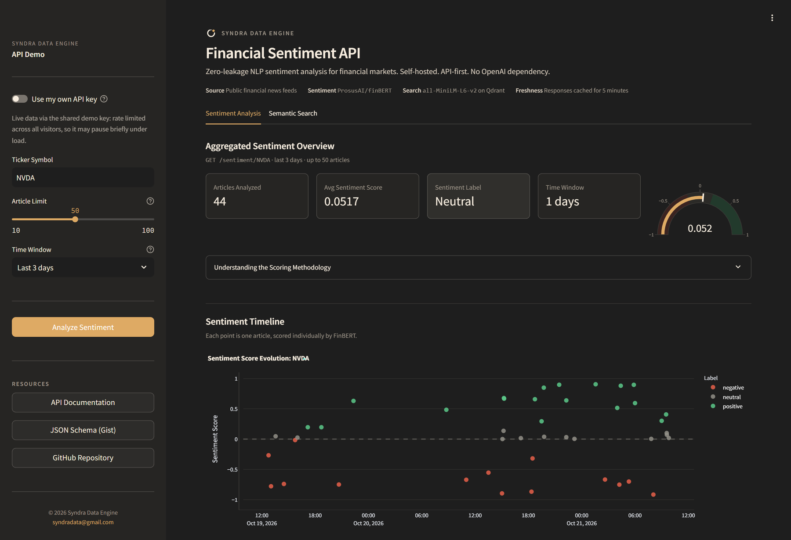
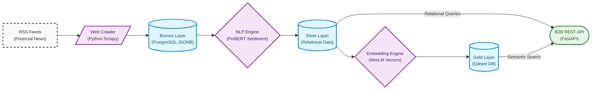

> ⚠️ **Note:** The actual codebase for Syndra is kept in a **private monorepo**.
>
> This public repository is the **Engineering & Architecture Log**: ADRs, playbooks and troubleshooting logs, plus the production infrastructure (`infra/`), the metrics module, the test suite and the benchmark scripts behind the empirical audit (`benchmarks/`).

<p align="center">
  <picture>
    <source media="(prefers-color-scheme: dark)" srcset="assets/public/syndra_logo_dark.png">
    
  </picture>
</p>

# Syndra - Financial News Sentiment DaaS


**[syndradata.com](https://syndradata.com/)** · **[Live demo](https://demo.syndradata.com/)** · **[API docs](https://api.syndradata.com/docs)**

**Syndra** is a B2B Data-as-a-Service (DaaS) platform for quantitative funds and financial intelligence systems. Every hour it ingests public financial news, scores each article with a financial sentiment model, indexes it for semantic search, and serves the result through a strictly typed, versioned REST API.

Built on the principle of **Zero Data Leakage**, Syndra runs 100% of its Natural Language Processing (NLP) models on its own server, with no calls to third-party AI APIs, so the data and the queries never leave its perimeter.

<p align="center">
  
</p>

---

## API Integration

Syndra acts as the programmatic intelligence layer for downstream trading and analytics platforms. Every request is authenticated with an API key, rate limited per client, and cached for 5 minutes.

### Ticker sentiment

**Request:**
```bash
curl -X GET "https://api.syndradata.com/api/v1/sentiment/NVDA?limit=2" \
     -H "X-API-Key: syndra_XXXXXXXXXXXXXXXXXX" \
     -H "Accept: application/json"
```

**Response:**
```json
{
  "status": "success",
  "ticker": "NVDA",
  "time_window": "24 hours",
  "aggregated_sentiment": "neutral",
  "average_score": 0.0449,
  "article_count": 2,
  "recent_signals": [
    {
      "title": "NVIDIA Launches OpenShell Reference Architecture for Safe AI Agents",
      "url": "https://finance.yahoo.com/technology/ai/articles/nvidia-launches-openshell-reference-architecture-094800780.html?.tsrc=rss",
      "published_at": "2026-10-21T09:48:00",
      "source": "Finance.yahoo.com",
      "sentiment_label": "neutral",
      "sentiment_score": 0.019
    },
    {
      "title": "European Ecosystem Builds World’s Most Efficient AI Factories With NVIDIA DSX",
      "url": "https://finance.yahoo.com/technology/ai/articles/european-ecosystem-builds-world-most-093500135.html?.tsrc=rss",
      "published_at": "2026-10-21T09:35:00",
      "source": "Finance.yahoo.com",
      "sentiment_label": "neutral",
      "sentiment_score": 0.0707
    }
  ]
}
```

### Semantic search

Finds articles by meaning rather than by keyword, optionally filtered by ticker.

**Request:**
```bash
curl -X GET "https://api.syndradata.com/api/v1/search/semantic?query=chip%20export%20restrictions&limit=2" \
     -H "X-API-Key: syndra_XXXXXXXXXXXXXXXXXX"
```

**Response:**
```json
[
  {
    "similarity_score": 0.6149,
    "title": "China's Chip Exports Double To $31 Billion As US Restrictions Fuel AI Demand",
    "tickers": [],
    "sentiment_label": "positive"
  },
  {
    "similarity_score": 0.6126,
    "title": "China steps up protection for chip designs in revised regulations",
    "tickers": [],
    "sentiment_label": "neutral"
  }
]
```

---

## Core Architectural Principles

Syndra prioritizes data immutability, reproducibility, and clear separation of concerns.

- **Zero Data Leakage (Local NLP):** Inference runs on CPU in isolated subprocesses on a single self-hosted server: [FinBERT](https://huggingface.co/ProsusAI/finbert) for sentiment and [all-MiniLM-L6-v2](https://huggingface.co/sentence-transformers/all-MiniLM-L6-v2) for embeddings. Both models are baked into the image at pinned revisions and loaded offline, so no run depends on an external model hub.
- **Medallion Architecture:**
  - *Bronze:* Raw articles as ingested, stored as schema-less JSONB in PostgreSQL and never mutated after insert.
  - *Silver:* Cleansed articles with their FinBERT sentiment and extracted tickers, in a relational PostgreSQL table that serves the API.
  - *Gold:* Article embeddings in Qdrant, ready for semantic search.
- **Strict Data Contracts (FastAPI / Pydantic):** Validated ingress and egress boundaries. Upstream data model shifts (e.g., changes in a feed's layout) fail fast at ingestion, preventing downstream database corruption.
- **Vector Search (Qdrant):** Financial news embeddings index semantic similarity, enabling contextual discovery beyond traditional keyword matching.

---

## System Architecture



---

## Technology Stack

- **Data Engineering:** Prefect (hourly workflow orchestration), Scrapy (Extraction).
- **Storage & Search:** PostgreSQL 15 (Relational & JSONB), Qdrant (Vector Database), Redis (response cache, API key cache, rate limiting).
- **Backend Services:** FastAPI, SQLAlchemy 2.0 (Async), Uvicorn.
- **MLOps:** PyTorch, Transformers, Sentence-Transformers, all on CPU.
- **Infrastructure:** Docker, Docker Compose V2, Caddy (sole ingress, automatic TLS), behind Cloudflare.
- **Observability:** Prometheus, cAdvisor and node exporter, with domain and ETL metrics derived from PostgreSQL.
- **Public Surfaces:** Streamlit (interactive demo), static HTML/CSS landing.

---

## System Topology

```text
syndra-data-engine/
├── backend/                  # API, ETL pipeline, NLP models, strictly typed DTOs
├── demo/                     # Public Streamlit demo, self-hosted at demo.syndradata.com
├── frontend/                 # Static landing page for syndradata.com
├── infra/                    # Production compose, Caddy, Prometheus and Postgres init
├── docs/                     # ADRs, Playbooks, and Incident Management
├── benchmarks/               # Reproducible performance experiments and their results
├── assets/                   # Images used by this README
├── deploy.sh                 # SHA-tagged, selective deployment to the VPS
├── check-observability.sh    # Read-only health check of production monitoring
├── check-compose-mounts.sh   # Verifies compose bind mounts exist before startup
├── run-integration-tests.sh  # Security tests against a throwaway local stack
├── Makefile                  # Shortcuts for local development and the VPS
├── docker-compose.yml        # Local development stack
└── README.md                 # Platform Entrypoint
```

---

## Technical Documentation

For detailed information on platform modules and architectural decisions, please refer to the engineering knowledge base:
- [Architecture Decision Records (ADRs)](./docs/architecture_decision_records.md)
- [Engineering Playbooks](./docs/engineering_playbooks.md)
- [Incident Response & Troubleshooting](./docs/troubleshooting.md)

---

## License

Copyright (C) 2026 Francisco Sánchez-Montesinos Molinero.

Syndra is licensed under the [GNU Affero General Public License v3.0](./LICENSE). You may use, study, modify and redistribute it under its terms. If you run a modified version as a network service, the AGPL requires you to offer its users the corresponding source code.

For use under different terms, such as embedding Syndra in a closed-source product, contact the author for a commercial license.
